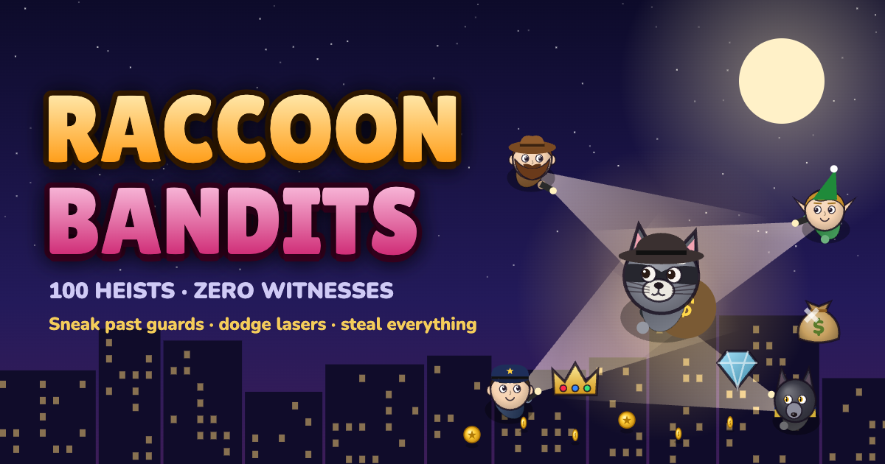

# Raccoon Bandits

A top-down stealth heist game with **100 unique levels**. Sneak past guards and their flashlights, avoid cameras, lasers, noisy floors and pressure plates, steal the loot, and escape to your getaway vehicle.



## Features
- 100 hand-designed heists across 10 chapters — a bank, an Egyptian museum guarded by the gods, Santa's workshop guarded by elves, a cowboy cantina, Atlantis, a volcano lair, a space station, a dragon's hoard and many more
- Themed security for every setting (police, elves, Anubis/Bastet/Horus, cowboys & cowgirls, robots, ninjas, vampires, mermaids…)
- 7 procedural layout styles (offices, caves, mazes, halls, city streets, ships/trains, concentric fortresses)
- Real-time line-of-sight lighting, flashlight cones, suspicion meters, noise, alarms, chases, hiding spots, vents
- Black Market shop: 11 tools (X-Ray Goggles, Glass Cutter, EMF Destabilizer, Hacking Tablet, Shadow Cloak, Grapple Glove…), 12 gadgets, 8 upgrades, cosmetics
- 300 hidden easter eggs, guard chatter, readable notes
- All art is hand-coded animated vector illustration (no emoji, no image assets); fully synthesized audio & music
- Keyboard, mouse and touch controls

## Controls
`WASD`/arrows move · `Shift` sneak · `E`/`Space` interact (hold) · `1–9` gadgets · `M` map · `Esc` pause

## Run locally
Static site, no build step:
```bash
python3 -m http.server 5173
```
Then open http://localhost:5173.
